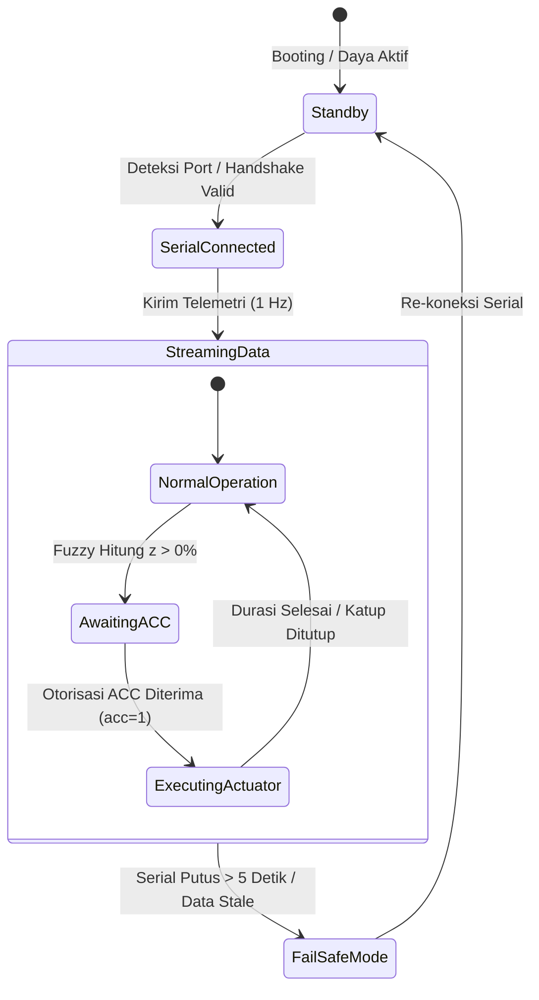

# Rencana Koneksi & Protokol Komunikasi ESP32 — Raspberry Pi 4B
## Sistem Cerdas Akuaponik Terpadu (Computer Vision & Kendali Fuzzy Sugeno)
**Stasiun Riset Eco Farm • Departemen Teknik Elektro dan Teknik Komputer FT UNNES 2026**

---

## 1. Ringkasan Eksekutif & Tujuan Perancangan
Dokumen ini mendefinisikan arsitektur komunikasi data berlatensi rendah (*low-latency*), berdaya tahan tinggi (*fault-tolerant*), dan aman antara:
* **Node 1: Raspberry Pi 4B (Master Supervisor)** — Peneliti: Felix Enrique (NIM 2305110019)
  * Fungsi: Akuisisi citra kamera CSI ov5647, segmentasi kanopi kangkung planar 24-zona, kalkulasi Plant Stress Index (PSI v2.0), web server terpadu, dan basis data telemetri.
* **Node 2: ESP32 DevKit V1 (Field Controller)** — Peneliti: Rafly Akbar Anggara (NIM 2305110006)
  * Fungsi: Akuisisi sensor analog mutu air kolam (pH SEN0161, Kekeruhan SEN0189, Suhu DS18B20, Level JSN-SR04T), modulasi aktuator (relay pompa kuras/isi air, aerator, feeder pakan), dan mesin inferensi Fuzzy Sugeno lokal.

Target performa:
* **Latensi RTT (Round Trip Time)**: $\le 5\text{ ms}$ (Wired USB Serial).
* **Throughput**: 1 payload per 1.000 ms (1 Hz continuous stream).
* **Ketahanan Operasi**: Fail-safe independen (ESP32 tetap aman jika Pi crash/reboot).

---

## 2. Topologi & Lapisan Fisik (Physical Layer)

### 2.1 Jalur Utama: Wired USB Serial (Baud Rate 115200 bps)
Kabel USB Type-A (dari Raspberry Pi) ke Micro-USB/Type-C (pada ESP32).

```text
+-------------------+                    +-------------------+
|  Raspberry Pi 4B  |                    |   ESP32 DevKit    |
|                   |                    |                   |
|  Port USB 2.0/3.0 |=====[ Kabel USB ]==| Port Micro/Type-C |
|  (/dev/ttyUSB0)   |  Daya 5V + Data    | (CH340 / CP2102)  |
+-------------------+                    +-------------------+
```

**Spesifikasi Teknis:**
* **Baud Rate**: `115200 bps` (8 data bits, no parity, 1 stop bit / 8-N-1).
* **Waktu Transfer Byte**: $1 / (115200 / 10) \approx 86,8\ \mu\text{s}$ per byte.
* **Waktu Transfer Paket (60 byte)**: $\approx 5,2\text{ ms}$.
* **Suplai Daya**: Port USB Pi menyuplai tegangan 5V DC stabil ke ESP32. Tidak memerlukan adaptor listrik tambahan untuk ESP32.

### 2.2 Jalur Cadangan (Failover): Wi-Fi Socket UDP Lokal (SoftAP)
Bila kabel USB terlepas atau modul berada pada jarak fisik terpisah:
* Raspberry Pi memancarkan Hotspot Wi-Fi SoftAP (`SSID: Ecofarm-Net`, IP Pi: `192.168.4.1`).
* ESP32 tersambung ke SoftAP tersebut (IP ESP: `192.168.4.2`).
* Komunikasi via UDP Port `5005` (Latensi $\approx 3\text{--}8\text{ ms}$).

---

## 3. Format Protokol Data (Line-Delimited JSON)
Setiap paket dikirim dalam satu baris string JSON yang diakhiri karakter *newline* (`\n`).

### 3.1 Paket A: Telemetri Kolam (ESP32 $\rightarrow$ Raspberry Pi)
Dikirim setiap **1 detik (1 Hz)** secara kontinu:
```json
{"node":"esp32","ph":6.85,"ntu":8.2,"temp":27.4,"lvl":68.0,"valve":0,"pump":1,"feed":0,"seq":104}\n
```

| Field | Tipe | Rentang | Keterangan |
|---|---|---|---|
| `node` | string | `"esp32"` | Identitas pengirim |
| `ph` | float | 0.00 – 14.00 | Pembacaan sensor pH air kolam |
| `ntu` | float | 0.0 – 100.0 | Kekeruhan air kolam SEN0189 (NTU) |
| `temp` | float | 15.0 – 45.0 | Suhu air kolam DS18B20 (°C) |
| `lvl` | float | 0.0 – 80.0 | Ketinggian permukaan air kolam (cm) |
| `valve` | int | 0 / 1 | Status katup solenoid kuras air (0: Tutup, 1: Buka) |
| `pump` | int | 0 / 1 | Status pompa sirkulasi/aerator |
| `feed` | int | 0 / 1 | Status servo dispenser pakan ikan |
| `seq` | int | 0 – 65535 | Nomor urut paket (Sequence Number) |

### 3.2 Paket B: Kanopi & Perintah Kontrol (Raspberry Pi $\rightarrow$ ESP32)
Dikirim segera setelah analisis kamera selesai atau saat pengelola menekan tombol konfirmasi pada dasbor:
```json
{"node":"pi4","psi":11.8,"cov":84.2,"z_rec":25.0,"cmd_drain":1,"dur_sec":90,"acc":1,"seq":104}\n
```

| Field | Tipe | Rentang | Keterangan |
|---|---|---|---|
| `node` | string | `"pi4"` | Identitas pengirim |
| `psi` | float | 0.0 – 100.0 | Indeks Stres Tanaman (*Plant Stress Index* v2.0) |
| `cov` | float | 0.0 – 100.0 | Rata-rata tutupan kanopi 24 zona (%) |
| `z_rec` | float | 0.0 – 100.0 | Rekomendasi volume pergantian air Fuzzy (%) |
| `cmd_drain` | int | 0 / 1 | Perintah buka katup pengurasan air |
| `dur_sec` | int | 0 – 600 | Durasi katup terbuka (detik) |
| `acc` | int | 0 / 1 | Otorisasi pengelola (0: Belum ACC, 1: Disetujui) |
| `seq` | int | 0 – 65535 | Nomor urut balasan |

---

## 4. Mesin Keadaan & Aturan Keselamatan (Fail-Safe State Machine)



### Aturan Keselamatan (Hard Safety Rules):
1. **Aturan Data Basi (*Stale Data Protection*)**:
   Jika ESP32 tidak menerima pembaruan dari Raspberry Pi selama $> 5$ detik, ESP32 mengabaikan perintah katup lama dan kembali ke mode siaga (*standby*).
2. **Kunci Dua Langkah (*Two-Step Actuation Lock*)**:
   Katup kuras air kolam **hanya boleh terbuka** jika dan hanya jika `cmd_drain == 1` DAN `acc == 1`.
3. **Batas Waktu Perangkat Keras (*Hardware Watchdog*)**:
   Katup solenoid memiliki *hard timeout* maksimal 180 detik di memori lokal ESP32 untuk mencegah kolam terkuras habis akibat galat perangkat lunak.

---

## 5. Rencana Tahapan Implementasi & Pengujian

| Fase | Target Kegiatan | Kriteria Keberhasilan | Waktu |
|---|---|---|---|
| **Fase 1** | Uji Fisik Serial USB & Handshake | Pi mendeteksi `/dev/ttyUSB0`; echo string berhasil dibalas $< 2\text{ ms}$. | Hari 1 |
| **Fase 2** | Integrasi Parser JSON Ringan | `ArduinoJson` (ESP32) & `json.loads` (Pi) membaca paket tanpa memory leak. | Hari 2 |
| **Fase 3** | Sinkronisasi Telemetri ke Dasbor | Sensor pH/NTU ESP32 tampil live di Tab 1 dasbor; PSI Pi terbaca di ESP32. | Hari 3 |
| **Fase 4** | Uji Loop Tertutup SPK Sugeno | Kekeruhan buatan dinaikkan $\rightarrow$ Rekomendasi muncul di Web $\rightarrow$ Tombol ACC ditekan $\rightarrow$ Katup ESP32 terbuka. | Hari 4 |

---

## 6. Template Kode Referensi Siap Pakai

### 6.1 Kode ESP32 (Arduino C++)
```cpp
#include <Arduino.h>
#include <ArduinoJson.h>

const unsigned long TX_INTERVAL = 1000;
unsigned long lastTx = 0;
uint16_t sequence = 0;

void setup() {
  Serial.begin(115200);
  while (!Serial) { delay(10); }
}

void loop() {
  // 1. Terima Perintah & Input PSI dari Raspberry Pi
  if (Serial.available() > 0) {
    String rx = Serial.readStringUntil('\n');
    StaticJsonDocument<200> docRx;
    if (deserializeJson(docRx, rx) == DeserializationError::Ok) {
      float psi = docRx["psi"] | 0.0;
      float cov = docRx["cov"] | 0.0;
      int cmd_drain = docRx["cmd_drain"] | 0;
      int acc = docRx["acc"] | 0;

      // Eksekusi aktuator aman
      if (cmd_drain == 1 && acc == 1) {
        // Buka katup solenoid pengurasan
      }
    }
  }

  // 2. Kirim Data Sensor Air Kolam ke Raspberry Pi
  if (millis() - lastTx >= TX_INTERVAL) {
    lastTx = millis();
    StaticJsonDocument<200> docTx;
    docTx["node"] = "esp32";
    docTx["ph"] = 6.92;      // Ganti dengan pembacaan analog pH
    docTx["ntu"] = 8.4;      // Ganti dengan pembacaan sensor SEN0189
    docTx["temp"] = 27.6;    // Ganti dengan pembacaan DS18B20
    docTx["lvl"] = 68.0;     // Ganti dengan pembacaan JSN-SR04T
    docTx["valve"] = 0;
    docTx["pump"] = 1;
    docTx["feed"] = 0;
    docTx["seq"] = ++sequence;

    serializeJson(docTx, Serial);
    Serial.println();
  }
}
```

### 6.2 Kode Raspberry Pi (Python Bridge `esp32_bridge.py`)
```python
import serial
import json
import time
import threading

SERIAL_PORT = "/dev/ttyUSB0"
BAUD_RATE = 115200

ser = serial.Serial(SERIAL_PORT, BAUD_RATE, timeout=0.2)
ser.reset_input_buffer()

telemetri_air = {"ph": 7.0, "ntu": 5.0, "temp": 27.0, "lvl": 65.0}

def serial_rx_worker():
    global telemetri_air
    while True:
        try:
            if ser.in_waiting > 0:
                raw = ser.readline().decode("utf-8", errors="ignore").strip()
                if raw.startswith("{") and raw.endswith("}"):
                    data = json.loads(raw)
                    if data.get("node") == "esp32":
                        telemetri_air = data
        except Exception:
            time.sleep(0.02)

threading.Thread(target=serial_rx_worker, daemon=True).start()

def kirim_ke_esp32(psi, coverage, z_rec=0.0, cmd_drain=0, acc=0):
    payload = {
        "node": "pi4",
        "psi": round(psi, 1),
        "cov": round(coverage, 1),
        "z_rec": round(z_rec, 1),
        "cmd_drain": int(cmd_drain),
        "acc": int(acc)
    }
    ser.write((json.dumps(payload) + "\n").encode("utf-8"))
    ser.flush()
```
